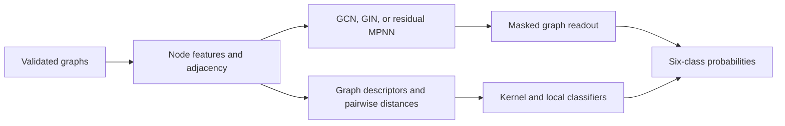

<h1 align="center">ENZYMES Graph Classifier</h1>

<p align="center">A reproducible benchmark for six-class protein graph classification.</p>

<p align="center">
  
  
  
</p>

<p align="center"><a href="#quick-start">Quick Start</a> · <a href="#results">Results</a> · <a href="#tests">Tests</a></p>

Compare GCN, GIN, and residual message-passing networks with a graph-similarity ensemble. The project includes seeded splits, held-out and nested evaluation, and checkpoint-based CSV inference.

## Quick Start

Create a CPU environment from the repository root.

```bash
python3 -m venv .venv
source .venv/bin/activate
python -m pip install torch --index-url https://download.pytorch.org/whl/cpu
python -m pip install '.[geometry]'
```

Download the public ENZYMES archive and run the neural benchmark. The converter preserves all 600 labels and assigns graph-local node indices. [TUDataset ENZYMES](https://chrsmrrs.github.io/datasets/docs/datasets/#bioinformatics)

```bash
mkdir -p data/tu
curl -fL https://www.chrsmrrs.com/graphkerneldatasets/ENZYMES.zip -o data/tu/ENZYMES.zip
enzyme-graph prepare-tu --archive data/tu/ENZYMES.zip
enzyme-graph --data data/tu inspect
enzyme-graph --data data/tu --device cpu benchmark \
  --split runs/tu-split.json --output runs/tu-baseline
```

## Architecture



Node inputs combine 18 numeric attributes with three one-hot categories. The GNNs standardize attributes on training nodes and use a mask for variable-size graphs. The similarity models combine node matching, approximate transport, and neighborhood agreement. The ensemble averages a base classifier and a variant with density-scaled distances.

## Results

The public workflow evaluates all models below on the same 72 held-out graphs.

| Model | Training graphs | Held-out macro-F1 | Held-out accuracy |
| --- | ---: | ---: | ---: |
| GCN-1 | 456 | 0.368 ± 0.042 | 0.394 ± 0.035 |
| GCN-2 | 456 | 0.367 ± 0.095 | 0.398 ± 0.066 |
| GIN | 456 | 0.602 ± 0.054 | 0.602 ± 0.049 |
| Similarity ensemble | 528 | **0.849** | **0.847** |

The ensemble also reached **0.829 macro-F1** in two repeats of nested 16-fold cross-validation on the 600-graph public dataset. Each outer fold used 562 or 563 training graphs. The neural results are means ± sample standard deviations across three seeds. [Public neural runs](docs/results/tu-baseline.json), [public similarity runs](docs/results/tu-geometry.json)

<p align="center">
  <a href="docs/results/tu-confusion.png"></a>
  <a href="docs/results/tu-roc.png"></a>
</p>

The earlier 480-graph CSV benchmark uses a separate evaluation protocol. Its similarity ensemble scored **0.81218 macro-F1** across two repeats of nested 16-fold cross-validation and **0.73963** on the 60-graph holdout. Each outer cross-validation fit used 450 graphs. The holdout fit used 420. [480-graph measurements](docs/results/geometry.json)

## Usage

Run the public geometry benchmark with the same split file as the neural benchmark.

```bash
python -m enzyme_graph.geometry_benchmark --device cpu \
  --data data/tu/train.csv --split runs/tu-split.json --output runs/tu-geometry
```

Use `--device cuda` with a GPU-enabled PyTorch build. On ROCm under WSL, set `HSA_ENABLE_DXG_DETECTION=1` before launching. The [benchmark guide](docs/benchmark.md) covers the original CSV release, the residual comparison, and saved-model inference.

## Tests

```bash
python -m unittest discover -s tests -v
```

The suite runs without a dataset download. It checks TU conversion, CPU training, checkpoint reload, prediction ordering, and graph invariance. GitHub Actions runs the same tests against the installed package.

## References

- Original protein graph representation. [Borgwardt et al., Protein Function Prediction via Graph Kernels](https://doi.org/10.1093/bioinformatics/bti1007)
- Degree-normalized graph convolution. [Kipf and Welling, Semi-Supervised Classification with Graph Convolutional Networks](https://arxiv.org/abs/1609.02907)
- GIN message passing. [Xu et al., How Powerful Are Graph Neural Networks?](https://arxiv.org/abs/1810.00826)
