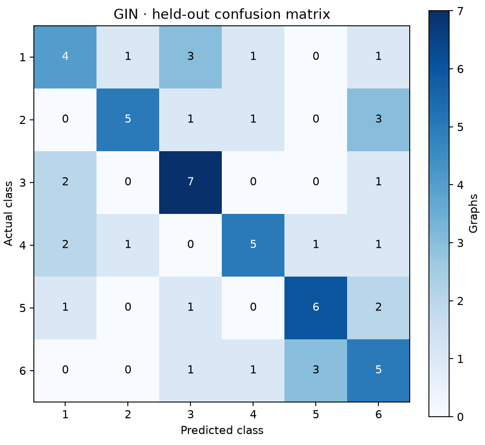
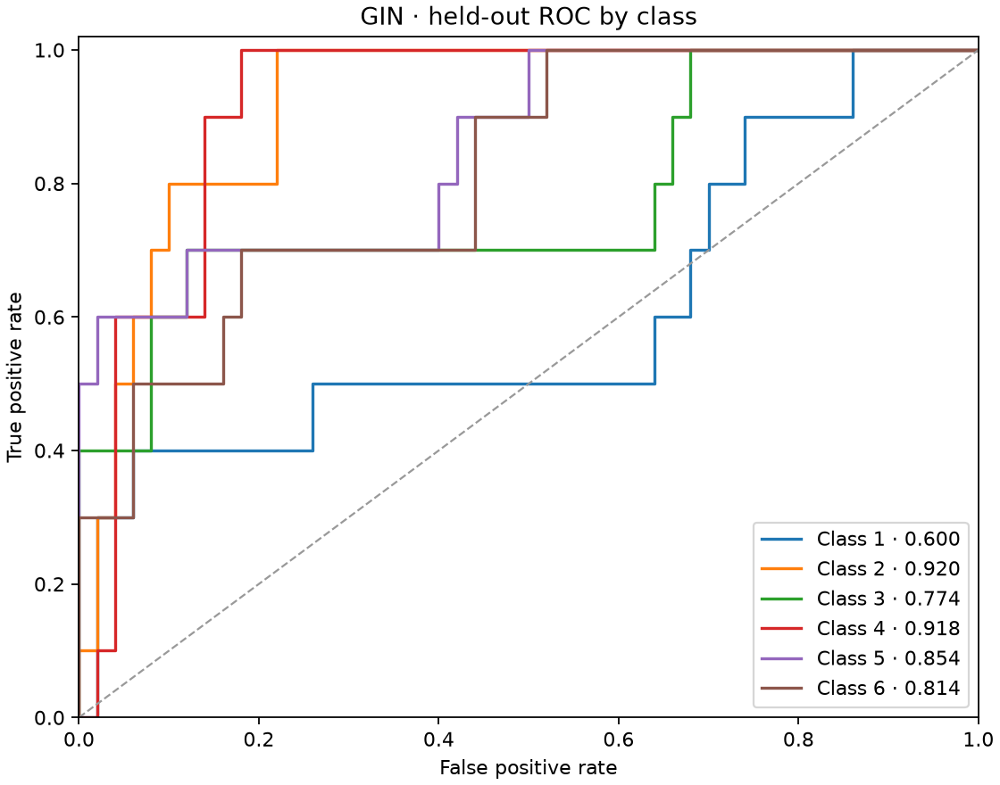
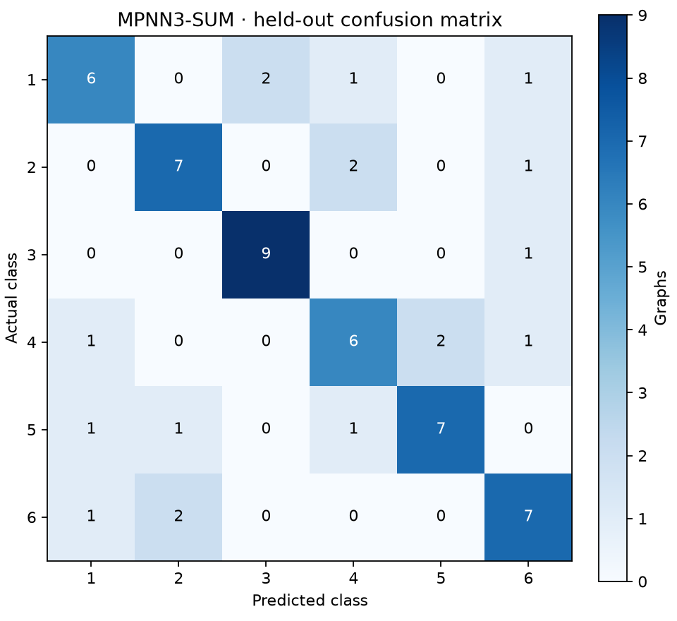
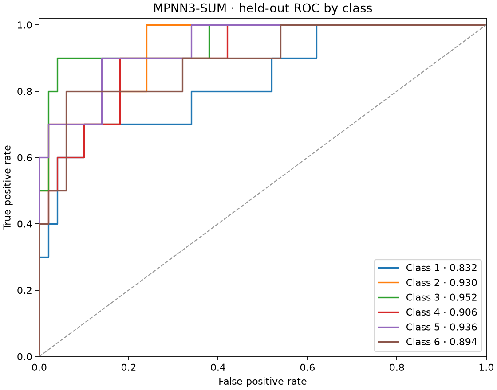

<h1 align="center">ENZYMES Graph Classifier</h1>

<p align="center">
  A reproducible PyTorch benchmark for six-class protein graph classification.
</p>

<p align="center">
  
  
  
</p>

<p align="center"><a href="#quick-start">Quick Start</a> · <a href="#residual-message-passing-results">Results</a> · <a href="#tests">Tests</a></p>

This benchmark compares a one-layer GCN, a two-layer GCN, a two-layer Graph Isomorphism Network (GIN), and residual message-passing networks on ENZYMES. The pipeline covers graph validation, seeded experiments, checkpoint-based inference, and per-class evaluation.

## Quick Start

Use Python 3.10 or newer. For a CPU setup on Linux:

```bash
python3 -m venv .venv
source .venv/bin/activate
python -m pip install torch --index-url https://download.pytorch.org/whl/cpu
python -m pip install .
python -m unittest discover -s tests -v
```

Obtain the ENZYMES CSV release from [Kaggle](https://www.kaggle.com/competitions/cse-5173-6073-hw-4-enzymes-graph-classification) and place `train.csv`, `test.csv`, and `sample_submission.csv` under `data/`. The benchmark uses the 480 labeled graphs in `train.csv`. The other two files are for inspection and prediction export.

```bash
enzyme-graph inspect
enzyme-graph --device cpu benchmark
```

On a WSL system with ROCm and a ROCm-enabled PyTorch installed, activate that environment and run `HSA_ENABLE_DXG_DETECTION=1 enzyme-graph --device cuda benchmark`. PyTorch uses the `cuda` device name for ROCm. In an existing environment, `python -m enzyme_graph.cli` from the repository root also runs the CLI.

## Architecture


Each node has 18 numeric attributes and one of three categories. Numeric features use training-only standardization and categories use one-hot encoding. Both GCNs use symmetric degree normalization with self-loops. GIN sums neighbors and adds a learned self-weight before each MLP. The three baselines use width 64, graph-level dropout of 0.2, and a shared pooling and classification design. Dense padding suits these small graphs (up to 126 nodes here) and costs quadratic adjacency memory as graph size grows.

## Usage

The baseline benchmark persists a stratified split with 360 training, 60 validation, and 60 test graphs. Adam and cross-entropy are shared across architectures. Each architecture tunes its learning rate on validation macro-F1 using seed 42, then repeats the selected configuration with seeds 43 and 44. The mean validation macro-F1 selects the winning architecture. All selected runs are scored on the same held-out test graphs.

```bash
enzyme-graph --device cpu evaluate --checkpoint runs/benchmark/gin-0.003-s42.pt

enzyme-graph --device cpu train --architecture mpnn3-sum --lr 0.001 --seed 42 \
  --epochs 21 --all-labeled --checkpoint runs/final.pt
enzyme-graph --device cpu predict --checkpoint runs/final.pt --output runs/submission.csv
```

Use checkpoints trained on the benchmark split for held-out evaluation. The all-labeled checkpoint is for inference on new graphs. Prediction export follows the provided sample's graph ID order. The benchmark writes metrics, epoch histories, checkpoints, and plots under `runs/benchmark/`.

## Baseline results

Held-out mean ± sample standard deviation across three training seeds on the same split. Training time includes the validation loop and early stopping; it excludes package import and GPU initialization. The recorded runs used batch size 32, two CPU threads, PyTorch 2.9.1 with ROCm 7.2.1, and an AMD Radeon 8060S under WSL.

| Model | Validation macro-F1 | Test macro-F1 | Test accuracy | Parameters | Mean training time |
| --- | ---: | ---: | ---: | ---: | ---: |
| Majority class | — | 0.048 | 0.167 | 0 | — |
| GCN-1 | 0.363 | 0.293 ± 0.027 | 0.294 ± 0.025 | 1,798 | 3.88 s |
| GCN-2 | 0.520 | 0.428 ± 0.093 | 0.439 ± 0.095 | 5,958 | 5.20 s |
| GIN | **0.622** | **0.535 ± 0.003** | **0.533 ± 0.000** | 14,280 | 5.20 s |

The balanced training split ties the majority-class rule, which picks class 1. GIN led by 0.106 test macro-F1 over GCN-2 at similar measured training time on this hardware. In the seed-42 confusion matrix, GIN got 7 of 10 class-3 graphs right and 4 of 10 class-1 graphs right. Class 1 also had the lowest one-vs-rest AUC, at 0.600. Each test class has only ten examples, and the reported variation reflects training seeds on a single split.

<p align="center">
  <a href="docs/results/confusion.png"></a>
  <a href="docs/results/roc.png"></a>
</p>

[Run-level metrics and learning-rate trials](docs/results/benchmark.json)

## Residual message-passing results

The follow-up adds residual message passing with masked mean, standard deviation, and max readouts from the input projection and every layer. Its input also includes log node degree, and its readout retains log graph size. The residual runs use AdamW, weight decay of 0.01, and label smoothing of 0.05.

```bash
enzyme-graph --device cpu compare-mpnn
```

The comparison uses five stratified development folds within the original 420 training and validation graphs. Each candidate uses learning rate 0.001. The highest mean fold macro-F1 selects the architecture, and the median best epoch sets its refit budget.

| Candidate | Mean development macro-F1 | Refit epochs |
| --- | ---: | ---: |
| 3-layer mean MPNN | 0.712 | 22 |
| 3-layer sum MPNN | 0.722 | 21 |
| 1-layer mean MPNN | 0.700 | 33 |

GIN and the selected residual model were refit on the same 420 graphs at seeds 42–44 and evaluated on the original 60 held-out graphs. These refits used the Radeon 8060S under WSL with batch size 32. Timing covers the fixed-epoch training loop.

| Model | Test macro-F1 | Test accuracy | Parameters | Mean training time |
| --- | ---: | ---: | ---: | ---: |
| GIN | 0.501 ± 0.027 | 0.506 ± 0.010 | 14,280 | 3.38 s |
| 3-layer sum MPNN | 0.644 ± 0.052 | 0.644 ± 0.051 | 311,336 | 4.06 s |

The 3-layer sum MPNN gained 0.143 held-out macro-F1 over the matched GIN refit. The figures show the selected model's seed-42 run.

<p align="center">
  <a href="docs/results/mpnn-confusion.png"></a>
  <a href="docs/results/mpnn-roc.png"></a>
</p>

[Residual model fold and refit metrics](docs/results/mpnn-comparison.json)

## Tests

`python -m unittest discover -s tests -v` runs the dataset-free CPU suite. The synthetic test covers CSV parsing, split integrity, training, checkpoint reload, held-out scoring, and prediction order. Additional tests cover stratified folds, padding, and node-order invariance. GitHub Actions runs the same suite on CPU.

## References

- ENZYMES graph representation and classification task. [Borgwardt et al., Protein Function Prediction via Graph Kernels](https://doi.org/10.1093/bioinformatics/bti1007)
- Degree-normalized graph convolution. [Kipf and Welling, Semi-Supervised Classification with Graph Convolutional Networks](https://arxiv.org/abs/1609.02907)
- GIN message passing. [Xu et al., How Powerful Are Graph Neural Networks?](https://arxiv.org/abs/1810.00826)
