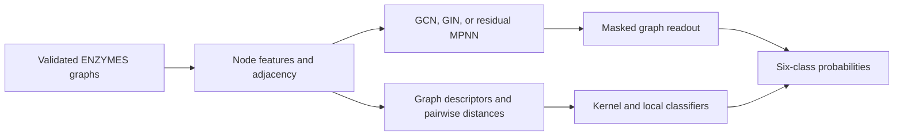
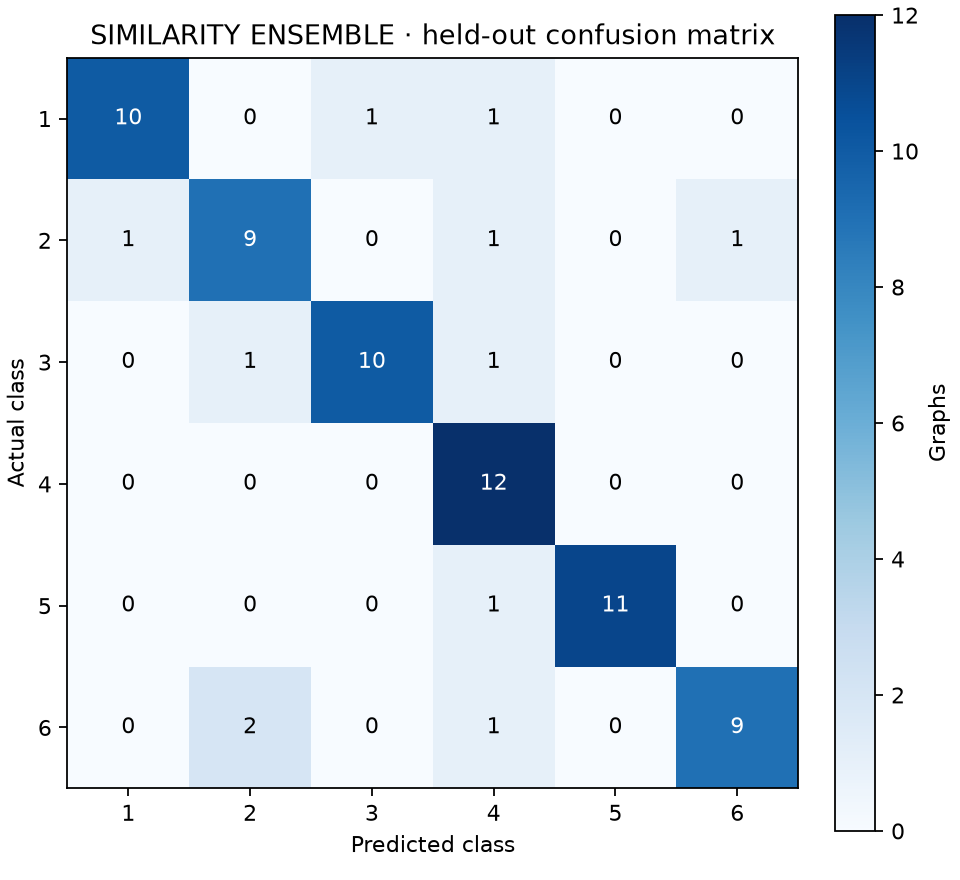
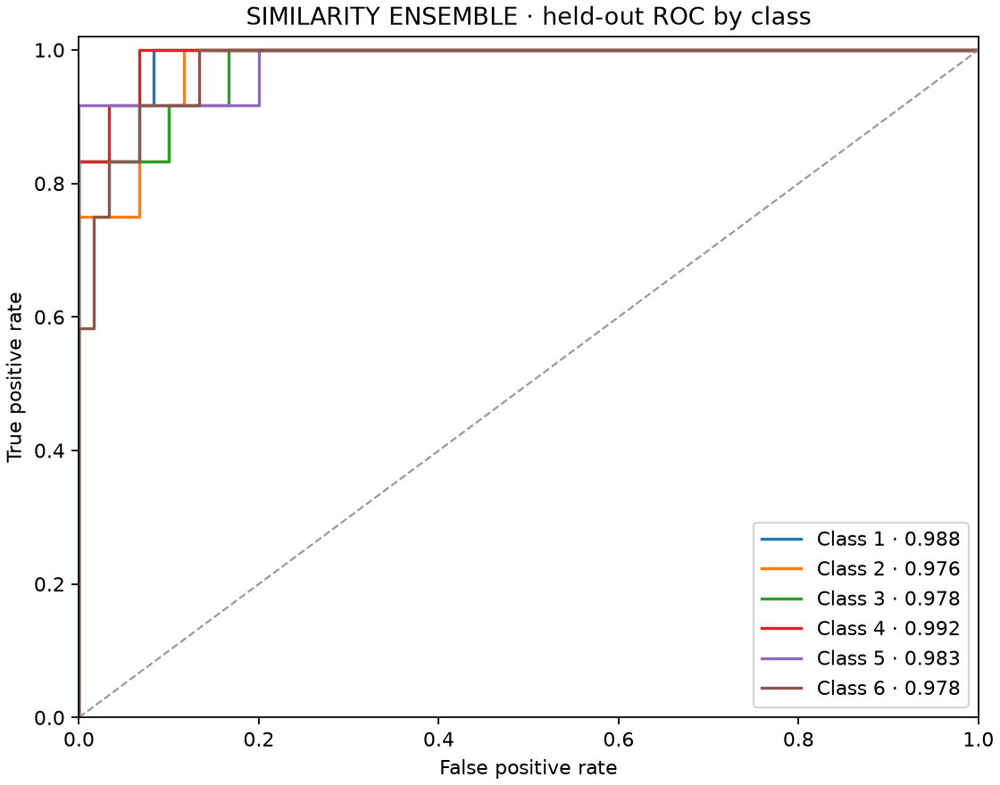

<div align="center">
  <h3>ENZYMES Graph Classifier</h3>

  <p>
    Six-class protein graph classification with <strong>graph neural networks</strong>,
    a <strong>graph-similarity ensemble</strong>, and reproducible evaluation.
    <br />
    <a href="#-getting-started"><strong>Quick Start »</strong></a>
  </p>

  <p>
    
    
    
    
  </p>
</div>

## 🔍 About The Project

This benchmark compares GCN, GIN, and residual message-passing networks with
a graph-similarity ensemble on ENZYMES. Each protein graph has one of six
labels. The workflow covers public dataset conversion, seeded splits,
checkpoint-based inference, and per-class evaluation. [Original protein graph representation](https://doi.org/10.1093/bioinformatics/bti1007)

## 🛠 Built With

- **Python 3.10+ and PyTorch** for graph batching, message passing, and training.
- **NumPy, SciPy, and scikit-learn** for graph descriptors, kernel classifiers, and calibration.
- **Matplotlib** for confusion matrices and one-vs-rest ROC plots.
- **AMD ROCm** for optional GPU execution under WSL.

## 📐 Architecture



### Technical Highlights

- **Node inputs.** Each node has 18 numeric attributes and one of three
  categories. Numeric attributes are standardized on training nodes for the
  GNNs. Masks keep padded nodes out of graph readouts.
- **Neural baselines.** GCN uses degree-normalized convolution, GIN uses
  sum aggregation, and the residual MPNNs pool feature means, standard
  deviations, and maxima. [GCN paper](https://arxiv.org/abs/1609.02907), [GIN paper](https://arxiv.org/abs/1810.00826)
- **Similarity ensemble.** Node matching, approximate transport, and
  neighborhood agreement feed two classifiers. One uses density-scaled
  distances. The ensemble averages their probabilities.
- **Nested evaluation.** Calibration uses only the outer training fold.
  Saved metrics distinguish fixed holdout results from pooled out-of-fold results.

### File Organization

```text
├── enzyme_graph/
│   ├── cli.py, tu_data.py               # Commands and public dataset conversion
│   ├── data.py, models.py, training.py  # Graph batching, GNNs, and inference
│   ├── benchmark.py, comparison.py     # Neural baseline and MPNN experiments
│   └── graph_geometry.py, geometry_*.py  # Similarity, evaluation, and inference
├── docs/
│   ├── benchmark.md                     # Protocols and reproduction commands
│   └── results/                         # Recorded metrics and figures
├── tests/                               # Dataset-free CPU checks
└── pyproject.toml                       # Package and optional dependencies
```

## 🚀 Getting Started

Use Python 3.10 or newer. The CPU setup works without a GPU.

```sh
git clone https://github.com/EnzoPicarel/enzyme-graph-classifier.git
cd enzyme-graph-classifier
python3 -m venv .venv
source .venv/bin/activate
python -m pip install torch --index-url https://download.pytorch.org/whl/cpu
python -m pip install '.[geometry]'
```

### Dataset

Download the public ENZYMES archive. The converter preserves all 600 labels
and rewrites edges with graph-local node indices. [TUDataset ENZYMES](https://chrsmrrs.github.io/datasets/docs/datasets/#bioinformatics)

```sh
mkdir -p data/tu
curl -fL https://www.chrsmrrs.com/graphkerneldatasets/ENZYMES.zip -o data/tu/ENZYMES.zip
enzyme-graph prepare-tu --archive data/tu/ENZYMES.zip
enzyme-graph --data data/tu inspect
```

## ⚡ Execution

```sh
# Train the GCN and GIN baselines.
enzyme-graph --data data/tu --device cpu benchmark \
  --split runs/tu-split.json --output runs/tu-baseline

# Evaluate the similarity ensemble on the same holdout and in nested folds.
python -m enzyme_graph.geometry_benchmark --device cpu \
  --data data/tu/train.csv --split runs/tu-split.json --output runs/tu-geometry
```

Use `--device cuda` with a GPU-enabled PyTorch build. Under WSL with ROCm,
set `HSA_ENABLE_DXG_DETECTION=1` before launching. The benchmark guide covers
residual MPNNs, the original CSV release, and saved-model inference. [Benchmark guide](docs/benchmark.md)

## 📊 Results

All models below use the same 72 held-out graphs from the public dataset.
Neural scores show means ± sample standard deviations across three seeds.

| Model | Training graphs | Held-out macro-F1 | Held-out accuracy |
| --- | ---: | ---: | ---: |
| GCN-1 | 456 | 0.368 ± 0.042 | 0.394 ± 0.035 |
| GCN-2 | 456 | 0.367 ± 0.095 | 0.398 ± 0.066 |
| GIN | 456 | 0.602 ± 0.054 | 0.602 ± 0.049 |
| Similarity ensemble | 528 | **0.849** | **0.847** |

The ensemble also reached **0.829 macro-F1** across two repeats of nested
16-fold cross-validation on all 600 graphs. Each outer fold used 562 or 563
training graphs. [Neural run data](docs/results/tu-baseline.json), [similarity run data](docs/results/tu-geometry.json)

<p align="center">
  <a href="docs/results/tu-confusion.png"></a>
  <a href="docs/results/tu-roc.png"></a>
</p>

On the earlier 480-graph CSV release, the ensemble scored **0.81218 macro-F1**
in nested cross-validation and **0.73963** on its 60-graph holdout. [480-graph results](docs/results/geometry.json)

## 🧪 Tests

```sh
python -m unittest discover -s tests -v
```

The suite runs without a dataset download. It checks TU conversion, CPU
training, checkpoint reload, prediction order, and invariance to node order
and padding. GitHub Actions runs the same suite against the installed package.

## 👥 Author

- **Enzo Picarel**
