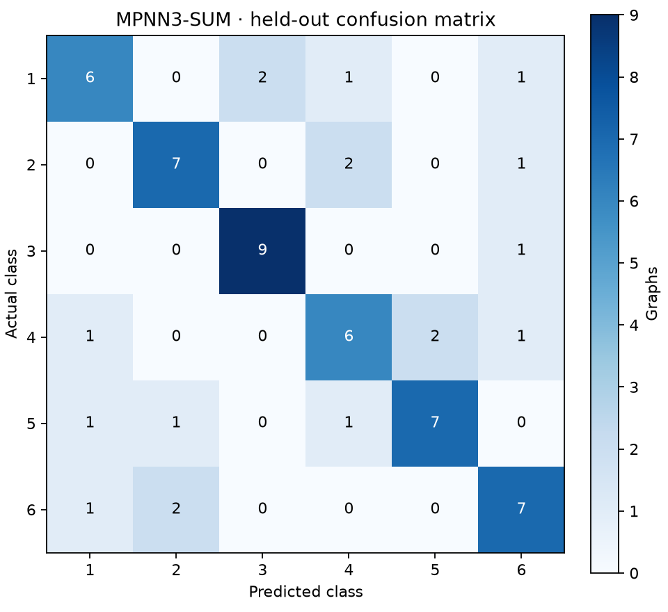
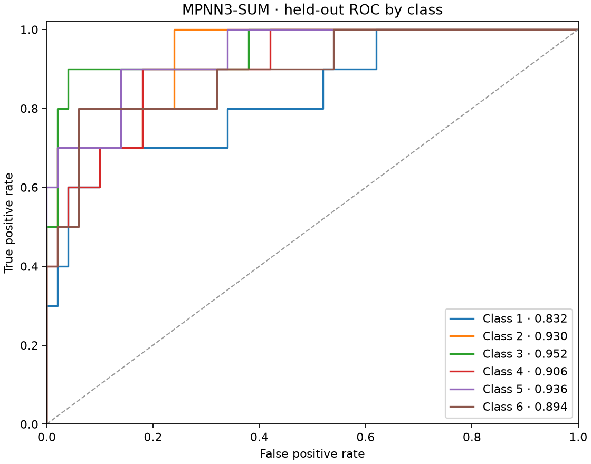

# Benchmark and Reproduction

## Data and protocols

The public workflow converts the original 600 labeled ENZYMES graphs to labeled CSV. Its baseline split has 456 training, 72 validation, and 72 test graphs. The converter prefixes IDs with `tu-`, and the README commands use dedicated output paths. [Public TUDataset release](https://chrsmrrs.github.io/datasets/docs/datasets/#bioinformatics)

The earlier CSV workflow starts from 480 labeled graphs. Place `train.csv`, `test.csv`, and `sample_submission.csv` in `data/` to reproduce those experiments. Only the labeled CSV is required for training and evaluation. Prediction uses the unlabeled CSV and the sample file. [480-graph CSV release](https://www.kaggle.com/competitions/cse-5173-6073-hw-4-enzymes-graph-classification)

| Evaluation | Labeled graphs | Held-out graphs | Training protocol |
| --- | ---: | ---: | --- |
| Public neural baseline | 600 | 72 | 456 train and 72 validation |
| Earlier neural baseline | 480 | 60 | 360 train and 60 validation |
| Earlier residual comparison | 480 | 60 | 420-graph refit after development-fold selection |
| Similarity holdout | 600 or 480 | 72 or 60 | Calibration within the labeled development partition |
| Similarity nested cross-validation | 600 or 480 | All outer-fold predictions pooled | Two 16-fold repeats with calibration inside each outer training fold |

## Neural models

Both GCNs use symmetric degree normalization with self-loops. GIN uses learned self-weights and sum aggregation. All three use a hidden width of 64 and masked mean pooling. Each architecture tunes its learning rate on validation macro-F1 using seed 42, then repeats the selected configuration with seeds 43 and 44.

Residual MPNNs pool the mean, standard deviation, and maximum before and after each layer. They include log node degree and graph size. The residual comparison selects a variant by mean macro-F1 over five development folds and uses its median best epoch for the refit. The candidates use AdamW with weight decay 0.01 and label smoothing 0.05.

```bash
enzyme-graph --device cpu benchmark
enzyme-graph --device cpu compare-mpnn
enzyme-graph --device cpu evaluate --checkpoint runs/benchmark/gin-0.003-s42.pt
```

Use a checkpoint trained on the matching benchmark split for held-out evaluation. The recorded GNN runs used batch size 32, two CPU threads, PyTorch 2.9.1 with ROCm 7.2.1, and an AMD Radeon 8060S under WSL. Training time includes validation and early stopping for the baselines.

| Model | Training graphs | Held-out macro-F1 | Held-out accuracy |
| --- | ---: | ---: | ---: |
| Majority class | 360 | 0.048 | 0.167 |
| GCN-1 | 360 | 0.293 ± 0.027 | 0.294 ± 0.025 |
| GCN-2 | 360 | 0.428 ± 0.093 | 0.439 ± 0.095 |
| GIN | 360 | 0.535 ± 0.003 | 0.533 ± 0.000 |
| GIN refit | 420 | 0.501 ± 0.027 | 0.506 ± 0.010 |
| Three-layer sum MPNN refit | 420 | 0.644 ± 0.052 | 0.644 ± 0.051 |

The rows share the same 60 held-out graphs. Neural scores show the mean and sample standard deviation across three training seeds. Each held-out class has ten examples. [Baseline metrics](results/benchmark.json), [residual metrics](results/mpnn-comparison.json)

<p align="center">
  <a href="results/mpnn-confusion.png"></a>
  <a href="results/mpnn-roc.png"></a>
</p>

## Graph similarity and inference

The similarity stack combines class-level distance summaries, kernel SVMs, and query-local logistic scores. Each component fits a calibration model on inner-fold predictions. The ensemble averages the base and density-adapted probabilities. A refit on all labeled data prepares an inference artifact.

```bash
python -m pip install '.[geometry]'
python -m enzyme_graph.geometry_benchmark --device cpu

python -m enzyme_graph.geometry_submission --device cpu fit \
  --train data/train.csv --split runs/split.json --geometry-test data/test.csv \
  --model runs/model.joblib

python -m enzyme_graph.geometry_submission --device cpu predict \
  --model runs/model.joblib --test data/test.csv --sample data/sample_submission.csv \
  --output runs/submission.csv
```

The prediction writer follows the sample file's graph ID order. The Joblib artifact contains the fitted estimators and their labeled references. Use artifacts you generated or obtained from a trusted source. The optional `--geometry-test` input preserves pairwise distance batching for the CSV release. Its graphs supply no labels to the model.
